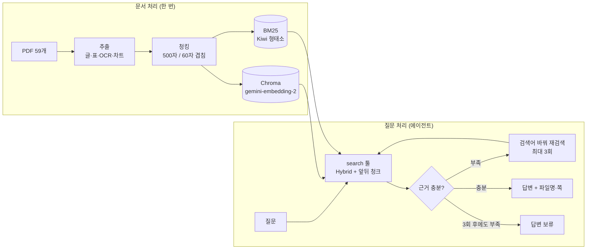

# 한국어 문서 RAG Agent

> 금융·공공·의료·법률·커머스 PDF 59개를 근거로 답하는 RAG 에이전트.
> 근거가 부족하면 검색어를 바꿔 다시 찾고, 끝내 없으면 지어내지 않고 **답변을 보류**한다.
> 실패 원인을 단계별로 분석해 고치면서 정답률을 **0.79 → 0.90**까지 올렸다.

<br>

## 핵심 결과

| 지표 (200문제, 2회 평균) | 결과 |
|---|---|
| **정답률** | **0.896** (시작 0.791 → +10.5%p) |
| 같은 조건의 기본 RAG 대비 | **+4.1%p** (0.855) |
| 표 질문 정답률 | 0.55 → **0.82** |
| 답이 없는 질문 보류율 | **100%** (지어낸 답 없음) |
| 평균 응답 시간 | 4.1초 (질문당 검색 평균 1.3회) |

- 평가: 직접 만든 골든셋 309문제(제공 267 + 직접 작성·검수 42), 비교 실험은 비율을 맞춰 뽑은 200문제
- 채점: LLM 채점(openevals) + 근거 쪽 적중 + 보류 판단 + 검색 과정(agentevals) + 실패 원인(RAGAS)

<br>

## 아키텍처



<br>

## 기술 스택

| 영역 | 사용 |
|---|---|
| 에이전트 | LangChain `create_agent`, `ToolCallLimitMiddleware`(검색 3회 제한), Pydantic 구조화 출력 |
| LLM | Gemini 3.5 Flash-Lite (답변·채점), Gemini 3.6 Flash (차트·다이어그램 변환) |
| 검색 | Chroma + gemini-embedding-2, BM25(rank-bm25 + Kiwi), RRF Hybrid |
| PDF 추출 | pdfplumber, RapidOCR(PP-OCRv5 한국어), rapid-layout, rapid-table |
| 평가 | openevals(LLM-as-judge), RAGAS, agentevals |

<br>

## 주요 구현

### 1. 멀티모달 PDF 추출
글만 읽으면 표·차트·스캔 페이지의 정보가 빠진다. 콘텐츠 종류마다 다른 방법을 썼다.

| 콘텐츠 | 방법 | 결과 |
|---|---|---|
| 글 | pdfplumber + 여백 제거 + 2단 편집 감지 | 1,258쪽 |
| PDF 표 | `find_tables()` → 마크다운 표 (1행·1열 가짜 표, 셀 글자가 빠진 깨진 표는 텍스트로) | 130개 |
| 이미지 속 글자·표 | RapidOCR + rapid-layout + rapid-table | 462곳, 표 56개 |
| 차트·다이어그램 | rapid-layout으로 찾기 → Gemini로 마크다운 변환 | 429개 |

### 2. 청킹
- 일반 문서: 500자 / 60자 겹침, **청크는 페이지를 넘지 않음** (출처 쪽을 정확히 남기기 위해)
- 의학 논문: 문단 단위 / 표: 행 단위로 자르고 헤더 반복 / 차트: 그림 하나 = 한 청크

### 3. 검색
- **Hybrid**: 벡터 검색 + BM25를 RRF로 합침 (의미 + 정확한 단어 둘 다 잡기)
- **앞뒤 청크 붙이기**: 찾은 청크의 같은 쪽 앞뒤 청크를 한 덩어리로 넘김 → 작게 찾고 넓게 읽기
- **분야 보완**: 에이전트가 분야를 골라도 전체 검색 결과를 섞어서, 분야를 잘못 골라도 놓치지 않게 함

### 4. 에이전트
- 검색 툴 하나를 가진 단일 에이전트. 근거 판단 → 재검색(최대 3회, 미들웨어로 강제) → 답변 또는 보류
- 출력은 구조화: `근거 판단 → 답변/보류 → 답변 → 근거(chunk_id, 파일, 쪽, 원문)`
- 실행 기록(질문, 답변, 검색어, 청크 ID, 시간)을 JSONL로 저장

<br>

## 실험과 개선 과정

평가 → 실패 원인 분석 → 수정 → 다시 평가를 반복했다. 같은 설정도 LLM 응답이 매번 달라 정답률이 1~2%p 흔들리므로, **중요한 비교는 두 번씩 돌려 확인**했다.

| 단계 | 바꾼 것 | 정답률 | 근거 |
|---|---|---|---|
| 시작 | 300/50 청킹, 표=MMR, 분야 필터 | 0.791 | |
| 청킹 | 300/50 → **500/60** | 0.819 | 300/50·500/60·800/100 비교 |
| 검색 | **앞뒤 청크 + 표도 Hybrid + 분야 보완** | 0.885 | RAGAS·agentevals 실패 분석 |
| 프롬프트 | 계산 허용, 질문 부분별 확인, 판단 먼저 | **0.896** | 남은 실패 패턴 분석 |

### 실패 분석으로 찾은 것
- **RAGAS**: 실패 34개 중 24개가 검색 문제였다. 정답 **쪽**은 찾았지만 답이 적힌 **조각**은 못 가져왔고, 에이전트는 받은 근거에 답이 없으니 보류한 것이었다. → 앞뒤 청크 붙이기
- **agentevals**: 분야를 잘못 고르면 정답률이 0.3 수준, 표 질문에 쓰던 MMR은 같은 표의 한 줄만 가져와서 오히려 불리했다. → 분야 보완, 표도 Hybrid
- **남은 실패**: 표 숫자로 계산하면 답할 수 있는데 "비교 문장이 없다"며 보류 → 프롬프트에 계산 허용 (표 정답률 0.67 → 0.82)

<br>

## 비교 실험

### 청킹 (검색 방식 고정)
| 청킹 | 검색 MRR (309문제) | 에이전트 정답률 (200문제, 2회) |
|---|---|---|
| 300/50 | **0.830** | 0.786 / 0.796 |
| **500/60** | 0.819 | **0.827 / 0.811** |
| 800/100 | 0.812 | 0.806 |

검색 점수는 300/50이 가장 좋았지만 실제 답 정확도는 500/60이 두 번 모두 높았다. **검색 지표만으로 청킹을 고르면 안 된다**는 걸 확인했다.

### 검색기 (청킹 고정, 309문제)
| 검색기 | MRR | hit@5 |
|---|---|---|
| Similarity | 0.822 | 0.938 |
| MMR | 0.814 | 0.895 |
| BM25 | 0.779 | 0.892 |
| **Hybrid** | **0.830** | **0.941** |

### 기본 RAG vs 에이전트 (최종 설정, 200문제, 2회)
기본 RAG는 검색기·모델·답변 규칙을 똑같이 두고 **재검색과 검색어 고르기만 뺐다**.

| | 에이전트 | 기본 RAG |
|---|---|---|
| 정답률 | **0.888 / 0.903** | 0.867 / 0.842 |
| 잘못된 보류 | **13 / 12** | 18 / 19 |
| 표 질문 | **0.818 / 0.818** | 0.758 / 0.697 |
| 답이 없는 질문 보류 | 100% | 100% |
| 응답 시간 | 4.1초 | **2.4초** |

- 에이전트가 약 4%p 더 정확하고 약 1.7배 느리다
- 두 번 다 에이전트만 맞힌 9문제: 재검색 덕분 5개, 검색어를 핵심어로 다듬은 덕분 4개
- 기본 RAG가 보류할 때만 에이전트로 넘기면(추정) 정답률은 비슷하고 시간은 3.0초로 줄어든다

<br>

## 배운 점
- **쪽 단위 지표는 원인을 잘못 짚게 할 수 있다.** 쪽을 찾은 것과 답이 적힌 조각을 찾은 것은 다르다. RAGAS로 내용 단위로 다시 보고서야 진짜 원인(검색)을 찾았다.
- **검색 점수 ≠ 답변 정확도.** 검색에 유리한 작은 청크가 답변에는 불리할 수 있다.
- **LLM 평가는 흔들린다.** 같은 설정을 두 번 돌려 차이가 흔들림보다 큰지 확인하고 결론을 냈다.
- **모르면 보류하게 만드는 것도 성능이다.** 남은 실패는 틀린 답보다 보류가 많다.

## 한계와 다음 단계
- 남은 "답이 있는데 보류"의 대부분은 **그래프·이미지 속 숫자** → 추출 품질 개선이 다음 과제
- 답이 없는 질문이 4개뿐이라 "지어내지 않음"을 보이기엔 부족 → 골든셋 보강·검수
- 채점도 LLM이 하므로 개별 판정에 오차가 있을 수 있음
- 기본 RAG → 에이전트 섞어 쓰기는 추정치 → 실제 구현해서 검증

<br>

## 결과물 둘러보기

### 예시: 차트 이미지 → 검색할 수 있는 표


```markdown
### [차트] 이커머스 디지털 광고비 증감 추이
- 출처: 리서치애드, 2022 / 단위: 억, %

| 연도 | 배너 (비중) | 동영상 (비중) | 총 광고비 | 전년대비 증감률 |
| --- | --- | --- | --- | --- |
| 2019 | 76% | 24% | 3,237억 | [표기 없음] |
| 2020 | 75% | 25% | 3,513억 | 9% |
| 2021 | 74% | 26% | 4,743억 | 35% |
```

글자로 된 PDF 텍스트에는 이 숫자들이 없다. 차트를 찾아 Gemini로 표로 바꿔야 "2021년 이커머스 광고비는?" 같은 질문에 답할 수 있다.

### 추출
| 보기 | 파일 |
|---|---|
| 59개 PDF 추출 결과 목록 (쪽 유형·표·이미지 수) | [INDEX.md](rag-agent-practice/output/extracted/INDEX.md) |
| 차트가 많은 보고서 (원본 이미지 + 변환 결과) | [MezzoMedia e커머스 보고서](<rag-agent-practice/output/extracted/preview/commerce/MezzoMedia 산업 보고서 e커머스.md>) |
| 표가 많은 자료집 (PDF 표 + 이미지 속 표) | [한-호주 퇴직연금 포럼](<rag-agent-practice/output/extracted/preview/finance/한-호주 퇴직연금 포럼_책자(최종).md>) |

### 청킹 (최종 500/60)
| 보기 | 파일 |
|---|---|
| 청크 수·길이 통계 (문서 유형·콘텐츠 종류·분야별) | [STATS.md](rag-agent-practice/output/chunks/base_500_60/STATS.md) |
| 표를 행 단위로 자르고 헤더를 반복한 예 | [한-호주 퇴직연금 포럼 청크](<rag-agent-practice/output/chunks/base_500_60/preview/finance/한-호주 퇴직연금 포럼_책자(최종).md>) |
| 차트 하나를 한 청크로 만든 예 | [MezzoMedia 청크](<rag-agent-practice/output/chunks/base_500_60/preview/commerce/MezzoMedia 산업 보고서 e커머스.md>) |
| 비교용 청킹 통계 | [300/50](rag-agent-practice/output/chunks/base_300_50/STATS.md) · [800/100](rag-agent-practice/output/chunks/base_800_100/STATS.md) |

### 평가 보고서
| 보기 | 파일 |
|---|---|
| 최종 에이전트 (분야별·근거 유형별 점수, 실패 사례) | [report.md](rag-agent-practice/output/eval/agent/goldenset_200__base_500_60__gemini-3.5-flash-lite__nb1_hybrid_fb_p2/report.md) |
| 같은 조건의 기본 RAG | [report.md](rag-agent-practice/output/eval/agent/goldenset_200__base_500_60__gemini-3.5-flash-lite__nb1_hybrid_fb_p2_rag/report.md) |
| RAGAS 실패 원인 분석 (검색 / 판단 / 지어냄 / 근거 읽기) | [report.md](rag-agent-practice/output/eval/ragas/goldenset_200__base_500_60__gemini-3.5-flash-lite/report.md) |
| agentevals 검색 과정 채점 | [report.md](rag-agent-practice/output/eval/trajectory/goldenset_200__base_500_60__gemini-3.5-flash-lite/report.md) |
| 검색기 비교 (309문제) | [report.md](rag-agent-practice/output/eval/retrieval/goldenset_all__base_500_60/report.md) |

> 결과 폴더 이름 규칙: `<골든셋>__<청킹>__<모델>__<검색 설정>_<프롬프트>`.
> 검색 설정 표시가 없는 폴더는 개선 전 검색 방식의 결과다.

<br>

## 실행 방법

```bash
cd rag-agent-practice
pip install pdfplumber rapidocr onnxruntime rapid-layout rapid-table beautifulsoup4 numpy pillow \
    langchain langchain-text-splitters langchain-google-genai langchain-chroma chromadb google-genai \
    rank-bm25 kiwipiepy openevals agentevals ragas instructor jsonref python-dotenv
```

`.env`에 `GOOGLE_API_KEY`를 넣고 실행한다.

```bash
python -m pipeline.agent "DC 퇴직연금에서 투자위험은 누가 부담하나요?" --show-searches
```

```bash
python -m pipeline.evaluate_agent --golden data/goldenset_200.csv
```

전체 파이프라인(추출 → 청킹 → 임베딩 → 평가) 실행 순서와 옵션은 [rag-agent-practice/README.md](rag-agent-practice/README.md)에 있다.

## 폴더 구조

```
rag_agent_practice/
├─ docs/                       설계·추출·날짜별 작업 정리
└─ rag-agent-practice/
    ├─ pipeline/               추출 → 청킹 → 임베딩 → 검색 → 에이전트 → 평가
    ├─ data/                   골든셋 (PDF 원본은 git 제외)
    └─ output/                 추출·청킹 결과, 평가 보고서 (eval/agent, ragas, trajectory, retrieval)
```

## 문서
- [설계](docs/agent와_설계.md) · [추출 정리](docs/추출.md) · [10/15 작업](docs/10_15.md) · [10/16 작업 (평가·개선)](docs/10_16.md)

---

데이터: [Allganize RAG-Evaluation-Dataset-KO](https://huggingface.co/datasets/allganize/RAG-Evaluation-Dataset-KO)
